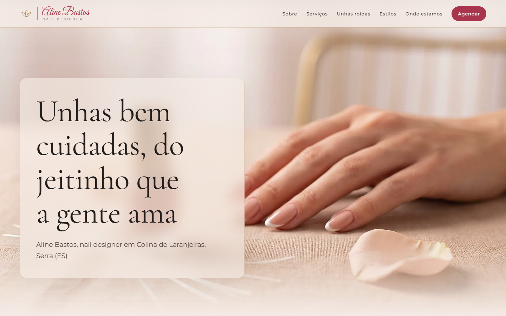
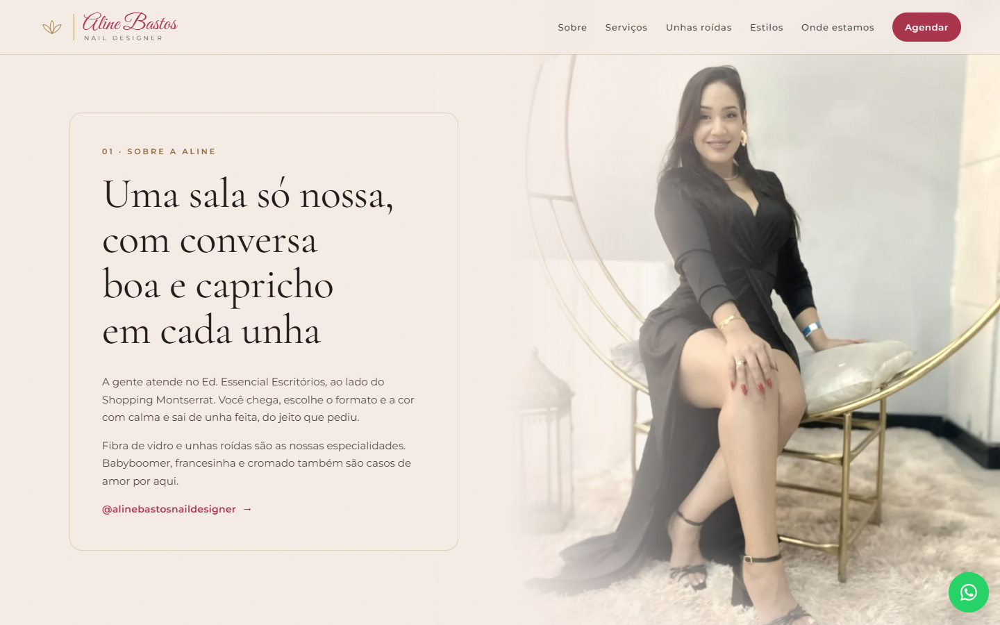
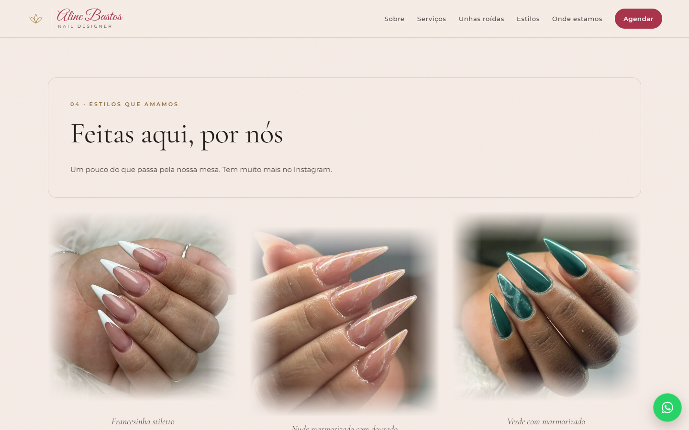
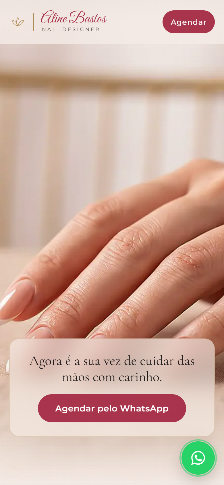

# Aline Bastos Nail Designer

Site cinematográfico para a nail designer Aline Bastos, de Colina de Laranjeiras, Serra (ES). Ela é especialista em alongamento em fibra de vidro e na recuperação de unhas roídas.

**Site no ar:** https://weversonfbr90.github.io/aline-bastos-nail-designer/



## O que o site faz

- **Abertura em vídeo controlada pela rolagem:** um vídeo de 8 s fatiado em 160 quadros WebP e desenhado num `<canvas>` conforme a página rola, com três momentos de texto sincronizados.
- **Serviços com consulta de valor:** cada serviço abre o WhatsApp com uma mensagem pronta citando aquele serviço.
- **Galeria de trabalhos reais**, com as bordas dissolvidas no fundo.
- **Formulário de contato** que envia para e-mail via FormSubmit.
- **Botão flutuante de WhatsApp**, mapa e layout pensado primeiro para o celular.
- **Identidade visual:** nude `#F6ECE6`, rosé vinho `#A8324A` e dourado `#B08D57`. Fontes Cormorant Garamond, Montserrat e Great Vibes.

| Sobre | Galeria | Celular |
|---|---|---|
|  |  |  |

## Tecnologias

HTML, CSS e JavaScript puros, sem dependências nem etapa de build.

## Rodar localmente

```bash
python -m http.server 4173
# abra http://localhost:4173
```

---
Site produzido com o Site Cinematográfico · Labrego IA (labregoia.com.br).
